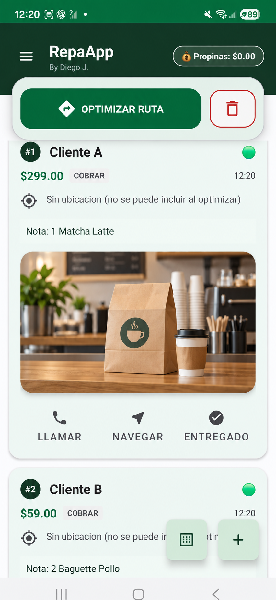
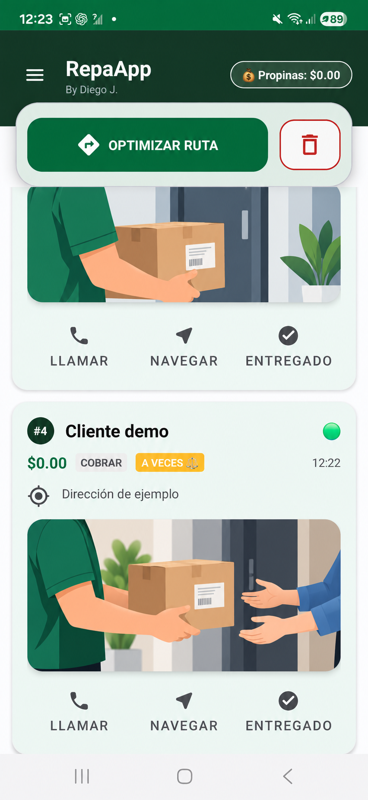
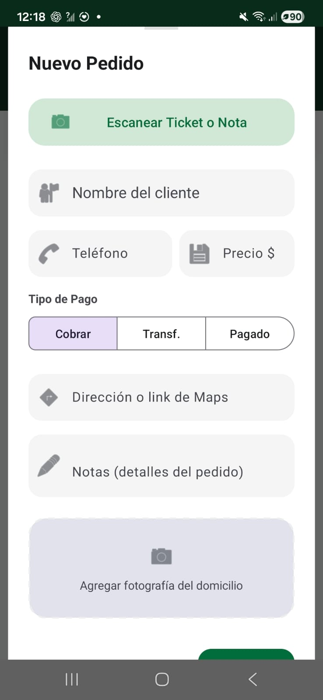

# Repartidor Rutas


Aplicación Android para organizar las entregas de un repartidor durante su jornada. Reúne pedidos, clientes y cobros en un solo lugar, y propone un orden de visita a partir de la ubicación actual.

Este repositorio contiene el código fuente del proyecto Android y su documentación. No incluye datos reales de clientes, claves de firma ni archivos generados de compilación.

## El problema

Cuando las direcciones llegan por distintos mensajes, es fácil perder tiempo alternando entre WhatsApp, el marcador telefónico, mapas y una lista de cobros. Repartidor Rutas concentra ese flujo en una app local para Android.

## Qué permite hacer

- Registrar pedidos manualmente o recibir texto compartido desde otra app para extraer coordenadas cuando están presentes.
- Guardar nombre, teléfono, dirección, notas, precio y forma de pago de cada pedido.
- Consultar y reutilizar perfiles de clientes frecuentes.
- Proponer un orden de entregas con un cálculo local de distancias en línea recta.
- Abrir el marcador y una app de navegación desde cada pedido.
- Marcar entregas, registrar propinas y revisar cobros pendientes.
- Capturar o seleccionar una foto y extraer datos de un ticket mediante reconocimiento de texto.
- Exportar e importar la lista de clientes en JSON.

El flujo completo se describe en [Funcionamiento](docs/FUNCIONAMIENTO.md).
La organización técnica se resume en [Arquitectura](docs/ARQUITECTURA.md), y los escenarios de prueba están en [Verificación](docs/VERIFICACION.md).

## Abrir y compilar

Requiere Android Studio con JDK 17 y Android SDK 34. Abre la raíz del repositorio como proyecto, espera la sincronización de Gradle y ejecuta la configuración `app` en un dispositivo o emulador con Android 7.0 (API 24) o superior.

En Windows también puedes ejecutar:

```powershell
.\gradlew.bat :app:assembleDebug :app:testDebugUnitTest :app:compileDebugAndroidTestKotlin
```

El APK de depuración queda en `app/build/outputs/apk/debug/` tras compilar. Todavía no hay un APK de distribución firmado ni una Release pública.

## Demostración

| Pedidos | Entrega | Nuevo pedido |
| --- | --- | --- |
|  |  |  |

Las dos primeras capturas se anonimizaron: nombres y fotos de lugares reales se sustituyeron por contenido de demostración. Por esa edición visual, algunos detalles pueden diferir de la interfaz original. La tercera muestra el formulario vacío. No se publican los archivos originales ni datos de clientes reales.

## Tecnología y decisiones

- Android nativo con Kotlin y vistas XML.
- Room para almacenar los datos localmente.
- Fused Location Provider para consultar la última ubicación disponible.
- Geocoder de Android para intentar convertir direcciones en coordenadas.
- ML Kit para reconocer texto en fotografías de tickets.
- Heurística de vecino más cercano y mejora 2-opt para ordenar paradas.

La ruta es una **estimación geométrica**: no considera calles, tráfico ni tiempos de conducción. El cálculo no requiere una API de rutas de pago.

## Estado del proyecto

Proyecto en desarrollo. La versión actual incluye migraciones de Room, correcciones de coordenadas, permisos y estadísticas, además de pruebas locales e instrumentadas. El 11 de octubre de 2026 se verificaron `assembleDebug`, `testDebugUnitTest` y `compileDebugAndroidTestKotlin` con resultado `BUILD SUCCESSFUL`. Las pruebas instrumentadas todavía deben ejecutarse en un dispositivo o emulador antes de presentar la app como versión estable.

## Qué demuestra este proyecto

Diseño de un flujo de trabajo móvil para repartidores, persistencia local con Room, integración con capacidades de Android, procesamiento de texto compartido, reconocimiento de tickets y optimización heurística de rutas.

## Privacidad

Los pedidos y perfiles se almacenan localmente en el dispositivo. Al compartir una ubicación o abrir navegación, intervienen las aplicaciones que el usuario elija. Los archivos JSON exportados pueden contener datos personales y deben manejarse de forma privada. Las capturas de este repositorio usarán exclusivamente datos ficticios.

## Próximos pasos

1. Validar los recorridos principales y las pruebas instrumentadas en emulador y teléfono.
2. Mejorar la jerarquía visual de la siguiente entrega y los estados de cobro.
3. Grabar un video breve del flujo con datos de demostración.

