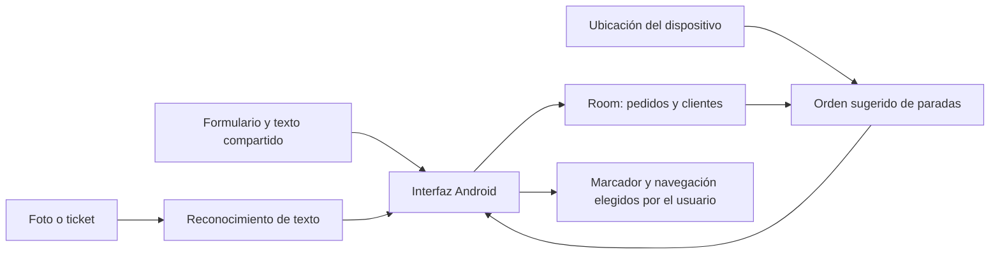

# Arquitectura y decisiones técnicas

Repartidor Rutas es una aplicación Android nativa que trabaja principalmente con datos locales. No depende de un servidor propio para registrar pedidos o calcular el orden de las paradas.

## Datos

Room almacena perfiles de clientes y pedidos. Un pedido conserva la información necesaria para una entrega: contacto, destino, importe, forma de pago, estado, propina y posición sugerida en la ruta. La lista principal observa cambios en los pedidos pendientes para actualizar la interfaz.

## Ubicaciones y ruta

La app extrae coordenadas de algunos textos compartidos y puede intentar geocodificar una dirección escrita. Para optimizar, usa la última ubicación disponible del dispositivo y solo incluye pedidos con coordenadas. El cálculo local combina una selección inicial de paradas con una mejora 2-opt; emplea distancia geográfica en línea recta.

**Límite:** este cálculo no conoce sentido de las calles, tráfico ni tiempo real de viaje. Es una ayuda para decidir el orden, no una navegación paso a paso.

## Integraciones del dispositivo

- Permisos de ubicación y cámara cuando se necesitan.
- Galería o cámara para asociar imágenes y escanear tickets.
- Reconocimiento de texto para sugerir datos que el usuario debe confirmar.
- Intenciones de Android para abrir el marcador y una aplicación de mapas.
- Selector de documentos para importar o exportar clientes.

## Calidad y trabajo pendiente

El proyecto incluye pruebas locales e instrumentadas para migraciones, coordenadas, FileProvider y propinas por fecha de entrega. Las pruebas instrumentadas y el flujo completo aún deben ejecutarse en un dispositivo o emulador para verificar el comportamiento real.

